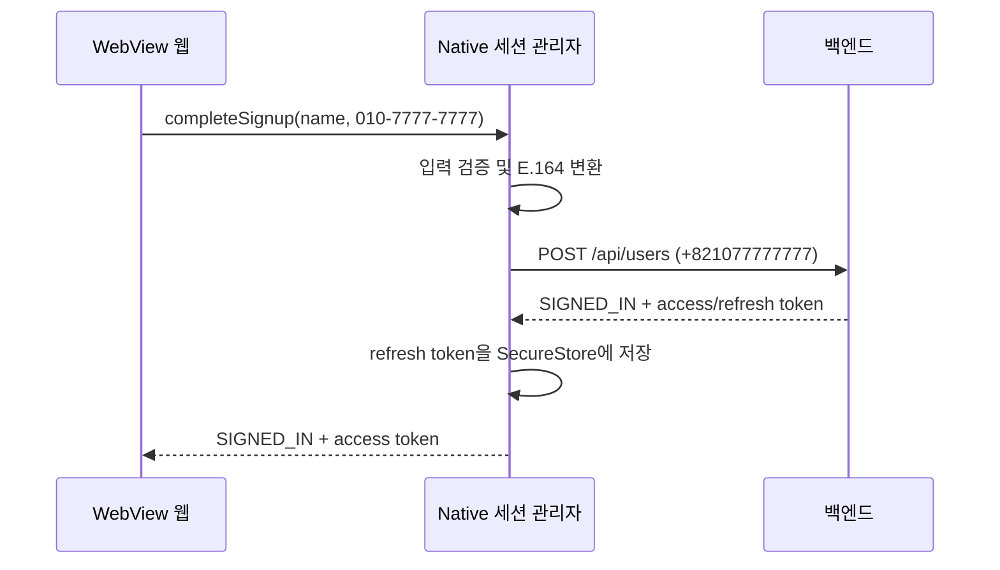
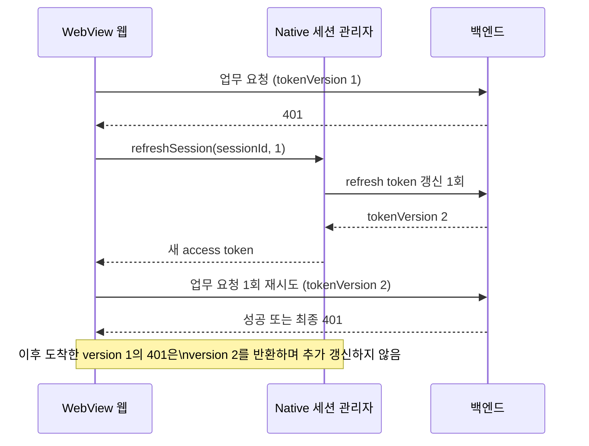

# 인증 API와 WebView 브리지 계약

> 초기 설계와 현재 공개 타입에 차이가 있다. #329는 마지막 보완 계약을 적용하며 serverRevoked·auth revision 등 미구현 필드를 새로 추가하는 작업으로 확장하지 않는다.

이 문서는 구현할 앱 계약이다. API wire schema의 단일 원천은 OpenAPI이며 생성 코드를 직접 고치지 않는다.
인증 명세 기준은 2026-11-04 수신본이다. [조사와 체크섬](../research.md)을 참고한다.

## backend 호출 매핑

모든 요청은 native에서 dev API로 보낸다. 서비스 웹 업무 API만 웹에서 bearer로 직접 호출한다.

| 동작        | 요청                                                                              | 성공                       | 오류                |
| ----------- | --------------------------------------------------------------------------------- | -------------------------- | ------------------- |
| Apple 인증  | POST /api/auth/oidc/apple/native-authentications, idToken·authorizationCode·nonce | 200 AuthenticationResponse | 400/401/503         |
| Google 인증 | POST /api/auth/oidc/google/native-authentications, idToken·nonce                  | 200 AuthenticationResponse | 400/401             |
| 가입        | POST /api/users, registrationToken·name·phoneNumber                               | 200 AuthenticationResponse | 400/401/409/500/503 |
| 갱신        | POST /api/auth/session-renewals, refreshToken                                     | 200 AuthenticationResponse | 400/401             |
| 로그아웃    | DELETE /api/auth/sessions/current, refreshToken                                   | 204                        | 400                 |
| 탈퇴        | DELETE /api/users/me, Authorization bearer, body 없음                             | 204                        | 401/503             |

main SDK 함수는 authenticateApple/authenticateGoogle/register/renew/revoke/withdraw다.
수신본의 가입 operationId는 register_1이며 격리 재생성한 SDK 이름은 register1이다.
재생성 후 register는 알림 기기 등록 PUT이므로 회원 가입에 잘못 연결하지 않는다.
갱신은 AuthSessionResponse 단독이 아니라 AuthenticationResponse를 반환한다.

## OIDC와 결과 검증

- 매 signIn마다 32 random bytes를 hex rawNonce로 만들고 UTF-8 SHA-256 lowercase hex를 SDK nonce로 전달한다.
- backend nonce에는 해시 전 rawNonce를 보낸다. Apple identityToken·authorizationCode는 Expo가 반환한 문자열을 검증한다.
- Google iOS Client ID와 serverClientID(Web Client ID)를 분리한다. SDK token은 서비스를 인증하는 access token이 아니다.
- SIGNED_IN은 user, session, accessToken, native refreshToken, 유효한 expiresIn이 있어야 한다.
- SIGNUP_REQUIRED는 registrationToken과 유효한 expiresIn이 있어야 하고 user/session은 null이어야 한다.
- 가입·갱신의 성공은 SIGNED_IN만 허용한다. 잘못된 성공 shape는 INVALID_RESPONSE로 처리한다.
- 이름·전화번호 이외 provider profile은 가입 필수값으로 쓰지 않는다. Apple이 이름/email을 다시 주지 않아도 동작한다.

## 브리지 메서드

공개 타입·런타임 schema는 packages/app-bridge, 구현은 apps/mobile, 소비는 apps/web에 둔다.
여섯 메서드는 기존 safe-area 계약과 함께 제공한다. 웹 호출 전 method availability를 확인한다.

| 메서드         | 입력                        | 결과                                                                    |
| -------------- | --------------------------- | ----------------------------------------------------------------------- |
| signIn         | provider: apple 또는 google | SIGNED_IN, SIGNUP_REQUIRED, CANCELLED 또는 ERROR                        |
| completeSignup | name, phoneNumber           | SIGNED_IN 또는 ERROR                                                    |
| getSession     | 없음                        | SIGNED_IN, SIGNUP_REQUIRED, SIGNED_OUT, AUTHENTICATING 또는 UNAVAILABLE |
| refreshSession | sessionId, tokenVersion     | SIGNED_IN, SIGNED_OUT 또는 UNAVAILABLE                                  |
| signOut        | 없음                        | SIGNED_OUT + serverRevoked(boolean), 또는 정리 실패 ERROR               |
| withdraw       | 없음                        | WITHDRAWN 또는 ERROR                                                    |

- 상태 판별자는 status로 통일한다. SIGNED_IN에는 session: {accessToken, expiresAt, userId, sessionId, tokenVersion}를 담는다.
- sessionId는 token을 포함하지 않는 불투명 세션 식별자, tokenVersion은 양의 안전한 정수다. 둘은 요청 시점의 세션 비교용이며 인증 자격을 대신하지 않는다.
- SIGNUP_REQUIRED에는 expiresAt만 담는다. registrationToken을 웹에 보내지 않는다.
- ERROR에는 code, retryable과 필요한 fieldErrors만 담는다. server 원문 메시지·SDK 예외·토큰을 전달하지 않는다.
- 오류 code: INVALID_INPUT, AUTH_REQUIRED, SIGNUP_EXPIRED, CONFLICT, BUSY, NETWORK, TIMEOUT, STORAGE, SERVER, INVALID_RESPONSE, OUTCOME_UNKNOWN, UNSUPPORTED.
- UNAVAILABLE은 NETWORK/TIMEOUT/STORAGE/SERVER/INVALID_RESPONSE 중 code와 retryable을 담는다.
- fieldErrors는 name 또는 phoneNumber와 REQUIRED/INVALID_FORMAT/TOO_LONG/ALREADY_EXISTS를 검증해 전달한다.
- app-bridge의 initialBridge에는 인증 성공 fallback을 만들지 않는다. postMessageSchema는 RPC 검증을 대신하지 않는다.

## 입력·조회 정책

- name은 trim한 빈 문자열을 거부한다. OpenAPI에 없는 최대 길이는 새로 정의하지 않고 backend TOO_LONG을 표시한다.
- 가입 화면은 Figma대로 `010-7777-7777` 형식으로 입력·표시한다. `completeSignup` 직전에 native가 공백·하이픈을 제거한 국내 휴대전화번호 `010`과 뒤 8자리를 검증하고, API body에만 `+8210`과 뒤 8자리 E.164 값으로 변환한다.
- 웹에는 E.164 값이나 `+82` 접두어를 표시·입력시키지 않는다. 이미 E.164 값을 받아들이는 별도 UI는 이번 범위에 없다.
- native에서 다시 검증한다. 이메일·다른 번호로 identity를 임의 병합하지 않는다.
- getSession은 memory 상태를 우선 조회하고, 필요한 경우 SecureStore refresh token으로 복구한다. 복구와 명시적 갱신은 같은 native single-flight 경로를 사용한다.
- refreshSession은 요청 당시 sessionId/tokenVersion을 검증·비교한다. 세션이 바뀌면 현재 상태만 반환하고, token만 교체됐으면 새 token을 반환하며 추가 갱신하지 않는다. 자세한 원자적 비교·재시도 규칙은 상태 모델을 따른다.
- signIn 중 getSession은 AUTHENTICATING을 반환한다. timeout 뒤 새로운 인증을 병렬 시작하지 않는다.
- 비민감 auth revision 변경을 구독해 지연 완료 후 getSession을 다시 읽는다. 화면 이탈한 로그인 callback은 탐색하지 않는다.
- HTTPS 서비스 origin만 release WebView로 허용한다. 개발 origin 예외는 개발 빌드에만 한정한다.

## 가입과 세션 전달

`refresh token`과 가입 token은 이 경로에서 WebView로 전달하지 않는다.

## 실패·재시도·정리

- SDK 취소는 ERROR가 아니라 CANCELLED. 중복 인증은 BUSY. 취소·실패 후 rawNonce와 provider 자격을 폐기한다.
- 20초 HTTP timeout과 network failure는 서버 실패 확정이 아니다. 가입·탈퇴는 OUTCOME_UNKNOWN으로 표시한다.
- 가입 400/409는 필드/충돌 오류. 401 만료·재사용은 새 인증. 명시적 rollback 오류는 만료 전 사용자 재시도를 허용한다.
- 가입 응답 유실은 새 OIDC 인증으로 확인한다. 삭제 요청은 자동 재시도하지 않는다.
- Apple 503의 알려진 오류는 새 Apple 인증 안내로 연결하되 알 수 없는 code는 일반 SERVER 오류다.
- 로그아웃은 refresh token을 꼭 포함한다. 토큰 없는 204는 서버 세션 폐기 증거가 아니다.
- 로그아웃은 서버 요청 실패에도 로컬 정리를 시도하며 serverRevoked=false를 표시한다. 저장소 삭제 실패를 성공으로 숨기지 않는다.
- 탈퇴는 서버 204 뒤 정리한다. 실패·응답 유실은 탈퇴 완료가 아니다. 401은 서비스 재인증 안내다.
- refresh token 회전·삭제와 지연 응답 정책은 [상태 모델](../data-model.md)에 따른다.

## 늦은 401과 single-flight

최종 401과 403은 추가 갱신 없이 오류로 처리한다. 로그아웃 또는 계정 변경 뒤의 이전 요청은 재시도하지 않는다.

## #329 보완 계약

공개 타입은 현재 `packages/app-bridge`가 원천이다. 메서드 이름·입출력 shape는 유지한다.
무효화된 로그인/가입 결과는 기존 CANCELLED 등 적용 가능한 결과로 반환하고 웹 공통 반영 경로가 세션·탐색에 적용하지 않도록 검증한다.
native auth-api는 생성 SDK의 HTTP status·통신 오류를 해석해 RenewalResult로 반환한다. SessionManager에는 HTTP 상태나 SDK 오류를 전달하지 않는다.

| 상황                                  | 자격 처리                                            | 결과/웹 처리                                 |
| ------------------------------------- | ---------------------------------------------------- | -------------------------------------------- |
| 현재 대상의 renew 401                 | 같은 대상인지 검사 후 삭제                           | SIGNED_OUT; 삭제 실패는 STORAGE              |
| 네트워크·timeout·5xx                  | 보존                                                 | NETWORK·TIMEOUT·SERVER, 재시도 가능          |
| 200의 잘못된 shape                    | 새 자격 공개 금지                                    | INVALID_RESPONSE                             |
| 저장·삭제 실패                        | 성공 공개 금지, 삭제 실패 시 현재 프로세스 복구 차단 | STORAGE                                      |
| 기타 4xx                              | 인증 무효로 임의 확정하지 않음                       | 생성 계약에 맞는 오류로 반환, 자동 반복 금지 |
| 브리지 준비 전·조회 undefined·timeout | 실제 로그아웃으로 판정하지 않음                      | UNAVAILABLE 또는 해당 오류, 재조회 제공      |
| 준비 완료 후 메서드 미지원            | 자격 추정 금지                                       | UNSUPPORTED 안내, 반복 RPC 금지              |

실패 조회 완료 후 visible 상태에서 최소 5초 간격으로 재조회한다. foreground·online·수동 재시도도 같은 진행 요청을 공유한다.
성공하면 장애 복구 타이머를 중단하고 숨김·unmount 시 정리한다. 지원하지 않는 앱에 무한 재시도를 하지 않는다.
query 결과도 이 작업에서 마련할 단일 웹 인증 경로의 작업 세대와 일관되게 적용해 취소된 오래된 조회가 로그아웃을 덮지 않게 한다.
Google은 iOS client ID와 webClientId를 각각 전달한다. raw nonce와 해시의 기존 서버 계약은 바꾸지 않는다.

보완 2단계 구현: renew 경계에서 HTTP 상태를 해석하고 20초 timeout·자동 재시도 0회를 명시한다.
401은 현재 세대·대상 refresh token 확인 직후 clear를 호출한다. 이전 세션의 응답은 CANCELLED이며 새 세션을 지우지 않는다.
400·403 등 나머지 4xx는 SERVER/retryable=false, 5xx는 SERVER/retryable=true로 반환하고 자격을 유지한다.
timeout은 TIMEOUT, 응답 없는 통신 실패는 NETWORK, 비정상 성공 응답은 INVALID_RESPONSE로 구분한다.
공통 자격 변환에서 빈 access/refresh token·안전한 정수가 아닌 userId·양의 정수가 아닌 expiresIn·범위를 벗어난 expiresAt을 거부한다.

RenewalResult는 success(credentials)·invalid-session·temporary-failure(reason)·invalid-response·rejected의 판별 union이다.
API 어댑터는 예외를 포함한 통신 결과를 이 타입으로 정규화한다. 세션 관리자는 세대·대상 확인 후 결과 종류에 따라 저장·삭제·보존과 AuthResult 변환만 수행한다.
로그인·가입·갱신의 공통 자격 검증은 native 내부 credentials.ts에서 공유한다. 공개 브리지 계약과 외부 의존성은 변경하지 않는다.
