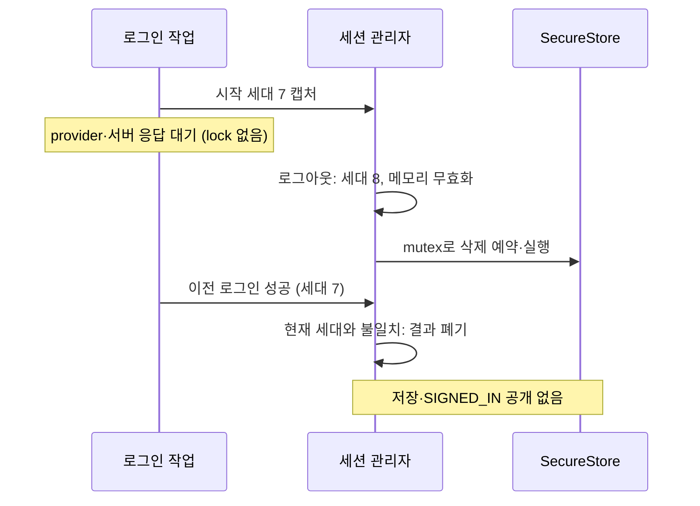

# 상태와 데이터 수명

> 최초 설계 기록을 보존한다. #329는 아래 보완 모델의 범위만 구현하며, 기존 auth revision 등 모든 설계 항목의 구현 완료를 주장하지 않는다.

## 저장 경계

| 데이터                                         | 위치                                       | 삭제/변경 시점                                     |
| ---------------------------------------------- | ------------------------------------------ | -------------------------------------------------- |
| provider ID token·authorization code·raw nonce | native 인증 시도 메모리                    | 교환 완료·실패·취소 후 제거                        |
| service refresh token                          | SecureStore                                | 갱신 때 교체, 확정 무효·로그아웃·탈퇴 성공 때 삭제 |
| service access token·만료시각·userId           | native 메모리; 검증된 RPC 결과로 웹 메모리 | 갱신·로그아웃·계정 변경                            |
| registration token·만료시각                    | native 메모리만                            | 가입 완료·만료·새 로그인·앱 종료                   |
| 이름·전화번호 입력                             | 가입 화면 메모리                           | 화면 종료·가입 완료; 웹 영구 저장 없음             |
| auth revision                                  | native bridge의 비민감 공유 상태           | 권한 상태·작업 결과 변경 때 증가                   |

provider token과 서비스 token을 혼동하지 않는다. web localStorage·URL·전역 공유 상태에 token을 저장하지 않는다.

## 외부 상태

- SIGNED_OUT: 복구 자격 없음 또는 서버가 무효를 확정함.
- AUTHENTICATING: 하나의 signIn 또는 completeSignup이 진행 중. 중복 호출은 BUSY.
- SIGNUP_REQUIRED: 아직 유효한 가입 자격이 있음. 웹에는 만료시각만 전달.
- SIGNED_IN: 검증된 서비스 access token과 userId가 있으며 만료시각을 전달 가능.
- UNAVAILABLE: 복구/갱신이 일시 실패했거나 저장 오류로 사용 불가. 보호된 화면을 노출하지 않음.

앱 재실행 복구, getSession의 필요 시 갱신, refreshSession은 native 세션 관리자 하나를 통하며 같은 세션의 진행 중 Promise를 공유한다. 사용자 수동 로그인과 refresh를 동시에 실행하지 않는다.
세션이 없을 때 restore는 SIGNED_OUT, 갱신 중 조회는 같은 갱신 결과를 기다린다.

## 갱신 single-flight와 늦은 401

- 세션에는 로그인/복구마다 발급하는 비민감 sessionId와 token 교체마다 증가하는 tokenVersion을 둔다. 웹 업무 요청은 전송 당시 둘을 캡처한다.
- 웹은 401에서 refreshSession({sessionId, tokenVersion})을 호출한다. native가 비교와 갱신 시작을 한곳에서 수행해 조회 후 갱신 사이의 경쟁을 막는다.
- 현재 sessionId가 다르거나 로그아웃 상태면 갱신하지 않고 현재 상태를 반환한다. 웹은 이전 요청을 다른 세션으로 재전송하지 않는다.
- 같은 sessionId에서 tokenVersion이 달라졌으면 이미 교체된 세션을 반환한다. 이전 token의 늦은 401 때문에 추가 갱신하지 않는다.
- 동일 버전이면 진행 중 Promise를 기다리고, 없을 때만 하나를 등록해 요청한다. 비교·등록 사이에 await를 두지 않는다.
- 새 refresh token의 저장과 generation 재확인 후에만 새 access token·tokenVersion을 공개하고 대기자에게 반환한다.
- 성공·실패 모두 finally에서 자신이 등록한 Promise일 때만 정리한다. 이전 작업이 새 세션의 진행 중 Promise를 지우지 않는다.
- 웹은 같은 세션일 때 원래 요청을 최대 한 번 재시도한다. 재시도도 401이면 오류를 반환하고 추가 갱신하지 않는다. 이전 응답만으로 현재 세션을 삭제하지 않는다.
- 네트워크/저장 실패는 기존 오류 정책을 따르며 모든 대기자가 같은 결과를 받는다. 403은 이 경로에 진입하지 않는다.

## 경쟁과 복구

1. signIn/completeSignup 시작은 현재 generation을 캡처하고 하나만 실행한다.
2. signOut 또는 탈퇴 성공은 generation을 바꾸고 앞선 요청의 결과 적용을 차단한다.
3. refresh 응답은 generation을 재검사하고 안전한 저장소에 새 refresh token을 쓴 뒤 공개한다.
4. 오래된 응답의 token을 저장하지 않는다. 이미 서버가 발급한 세션은 가능한 경우 해당 refresh token으로 정리한다.
5. 저장소 쓰기/삭제는 직렬화하여 로그아웃 삭제 뒤 늦은 쓰기가 재인증 자격을 남기지 않게 한다.
6. 갱신 응답 유실은 기존 token을 보존하고 일시 오류로 표시한다. 다음 서버 확인이 401이면 재인증한다.
7. 저장 실패는 성공으로 공개하지 않는다. 삭제도 실패하면 정리 실패를 표시하고 현재 프로세스의 복구를 차단한다.

## 만료와 오류

- expiresIn은 양의 유한 정수로 검증하고 수신 시각 기준 expiresAt(ms)으로 변환한다.
- access 만료 30초 전부터 갱신 대상으로 취급한다. 실제 권한 판단은 서버 응답을 따른다.
- 가입 토큰 만료는 로컬 타이머만 신뢰하지 않고 제출 직전과 서버 오류에서도 확인한다.
- 업무 요청의 401은 위 sessionId/tokenVersion 정책으로 처리한다. 인증·가입·갱신·탈퇴 요청에는 업무 요청 재시도 인터셉터를 적용하지 않는다.
- 생성 Zod의 int64 bigint를 브리지 JSON으로 내보내지 않는다. 안전한 정수 범위를 확인해 number로 변환한다.
- 사용자 identity는 검증된 AuthenticationResponse.user.id에서 얻으며 프로필/승인 상태 조회 API를 새로 가정하지 않는다.

## #329 보완 모델

- 작업 문맥은 시작 시점의 generation과 필요 시 sessionId/tokenVersion/refresh token을 내부에서 보관한다. token은 비교에만 사용하며 외부 식별자로 노출하지 않는다.
- p-mutex는 저장 순서를 보장하고 generation은 오래된 결과의 유효성을 판별한다. 둘 중 하나만으로 로그아웃 경합을 해결했다고 보지 않는다.
- logout은 즉시 generation을 올리고 메모리 세션·가입 자격을 무효화한다. 서버 revoke에는 캡처한 이전 token을 쓰고 로컬 삭제를 먼저 예약한다.
- 새 로그인 결과의 공개는 검증→같은 세대 확인→저장→같은 세대 재확인→메모리 확정 순서다. 로그아웃 이후 오래된 SIGNUP_REQUIRED도 공개하지 않는다.
- restore 읽기 뒤 세대가 바뀌면 읽은 자격을 메모리에 넣거나 renew에 사용하지 않는다. 저장이 이미 시작됐다면 뒤따르는 logout 삭제로 정리한다.
- 오류 정리에도 같은 세대·대상 검사를 적용한다. 오래된 renew 401이 새 계정을 삭제하지 않는다.
- 웹 작업 세대는 #328의 공통 경로를 사용한다. native generation을 공개 계약에 추가하지 않으며 두 세대가 동일한 값이라고 가정하지 않는다.
- AuthActions는 진행 중인 인증의 세대를 기록해 같은 세대의 로그인·가입 중복을 거부한다. 이전 세대의 finally는 새 인증의 진행 표시를 지우지 않는다.
- 로그아웃과 새 로그인 시작 시 이전 가입 자격을 제거한다. provider·인증 API·가입 API의 늦은 결과와 오류는 세대 검사 후 폐기한다.
- revoke 대기 중 새 세션이 확정되거나 새 로그인·가입 대기가 시작되면, 이전 로그아웃의 결과도 CANCELLED로 반환해 새 흐름에 적용하지 않는다.

