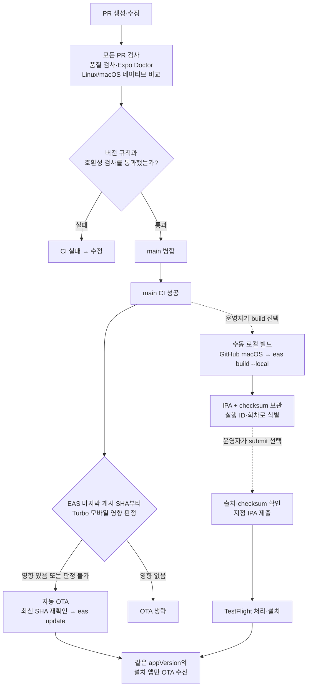
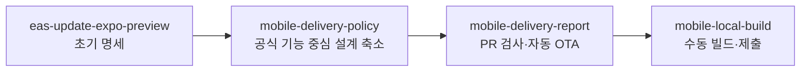

# 모바일 배포 흐름과 구현 현황

현재 정책은 **appVersion 유지·main 자동 OTA·수동 로컬 빌드·PR 버전 누락 검사**다.
요구사항은 [명세](spec.md), 실행 방법은 [모바일 README](../../apps/mobile/README.md), 검증 이력은 [validation.md](validation.md)를 따른다.

## 배포 흐름

아래 흐름은 main에 적용됐다. **원격 CI·OTA 게시·서명 빌드·제출은 성공했고, 실기기 수신과 복구 검증은 남아 있다.**

- 네이티브 변경에는 앱 버전 증가가 필요하며 버전 감소는 항상 거부한다. 수집 실패·OS별 지문 불일치도 실패다.
- main CI가 실패하면 자동 OTA를 실행하지 않는다. 성공했더라도 오래된 SHA면 게시하지 않는다.
- 새 runtime의 OTA를 먼저 게시해도 기존 runtime의 앱에는 전달되지 않는다. 새 로컬 빌드를 설치해야 받을 수 있다.
- 자동 OTA와 수동 빌드·제출은 같은 concurrency 그룹으로 직렬 실행한다.
- 빌드 존재 조회·자동 빌드 분기·설치 후 활성화 기준 파일은 사용하지 않는다.

## 복구 흐름

OTA로 수정할 수 없는 네이티브 결함은 새 빌드로 수정한다. 실패 후 재실행 전에는 EAS·App Store Connect 결과를 먼저 확인한다.

## 브랜치와 검토 단위

브랜치 이름의 공통 접두사는 `DongjaJ/`다. 화살표는 도입 당시 PR base 관계다. PR #374–#377은 main에 병합됐고, 후속 설치 수정 PR #380도 병합됐다.

## 구현 상태 스냅샷

기준: 2026-11-08, 검증 소스 `3b7ca130` (설치 오류 수정 #380 포함).

| 작업                                     | 상태                            | 근거                                                                                                                          |
| ---------------------------------------- | ------------------------------- | ----------------------------------------------------------------------------------------------------------------------------- |
| 명세·설계·자동 OTA·수동 빌드 구현        | main 병합 완료                  | PR #374–#377, #380                                                                                                            |
| 원격 PR 검사                             | Linux/macOS 및 품질 검사 통과   | [PR #380](https://github.com/YAPP-admin/yapp-plus-frontend/pull/380)                                                          |
| main CI                                  | 성공                            | [실행 42455644074](https://github.com/YAPP-admin/yapp-plus-frontend/actions/runs/42455644074)                                 |
| 자동 OTA 게시                            | testflight / runtime 1.0.1 성공 | [Expo 업데이트](https://expo.dev/accounts/yapp-plus-official/projects/yapp-plus/updates/c931c66e-5d99-483c-80c9-146bc6d4a154) |
| 서명·로컬 빌드·IPA 보관                  | 앱 1.0.1 / 빌드 20 성공         | [빌드 실행](https://github.com/YAPP-admin/yapp-plus-frontend/actions/runs/42455684488), 1회차                                 |
| 지정 IPA 제출                            | App Store Connect 업로드 성공   | [제출 실행](https://github.com/YAPP-admin/yapp-plus-frontend/actions/runs/42456807290)                                        |
| TestFlight 사용 가능                     | 사용자 메일 수신 확인           | 실제 설치 성공과는 구분                                                                                                       |
| 실기기 설치·OTA 수신·다른 runtime 미수신 | 미검증                          | 후속 기기 확인 필요                                                                                                           |
| fork CI·main 필수 검사 설정              | 미검증                          | 후속 운영 설정 확인 필요                                                                                                      |
| rollback·자동 OTA 재개                   | 후속 테스트 예정                | 대상·일정과 실행 승인 후 검증                                                                                                 |

다음 작업은 TestFlight 설치·주요 기능·OTA 수신 확인이다. Rollback은 지금 실행하지 않고 별도 테스트로 진행한다.

## Turbo 영향 판정 후속 변경

영향 판정 구현은 로컬 검증 단계이며 아직 main에 배포하지 않았다. EAS 공식 조회와 Turbo를
사용하며 별도 게시 기준 파일은 없다. 모바일 내부 문서는 보수적으로 포함한다.
기록 부재·판정 오류는 게시로 처리하고 영향 조건 제거로 기존 항상 게시 방식에 복귀할 수 있다.
