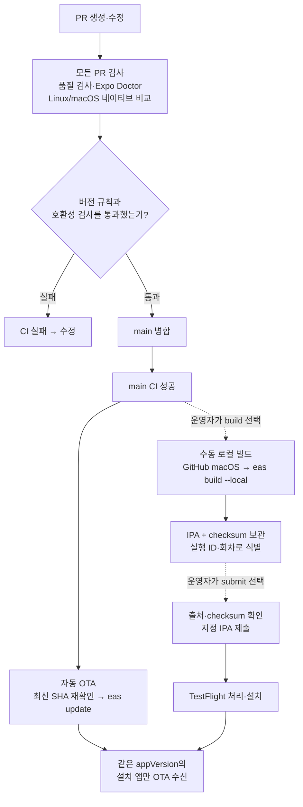
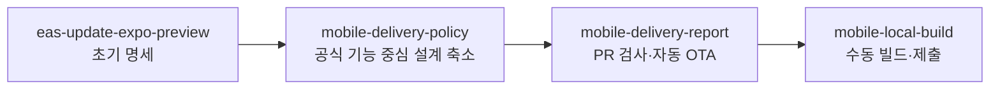

# 모바일 배포 흐름과 구현 현황

현재 정책은 **appVersion 유지·main 자동 OTA·수동 로컬 빌드·PR 버전 누락 검사**다.
요구사항은 [명세](spec.md), 실행 방법은 [모바일 README](../../apps/mobile/README.md), 검증 이력은 [validation.md](validation.md)를 따른다.

## 배포 흐름

아래는 구현한 코드가 main에 적용됐을 때의 흐름이다. **실제 원격 CI·빌드·제출·OTA 검증은 아직 완료하지 않았다.**

- 네이티브 변경에는 앱 버전 증가가 필요하며 버전 감소는 항상 거부한다. 수집 실패·OS별 지문 불일치도 실패다.
- main CI가 실패하면 자동 OTA를 실행하지 않는다. 성공했더라도 오래된 SHA면 게시하지 않는다.
- 새 runtime의 OTA를 먼저 게시해도 기존 runtime의 앱에는 전달되지 않는다. 새 로컬 빌드를 설치해야 받을 수 있다.
- 자동 OTA와 수동 빌드·제출은 같은 concurrency 그룹으로 직렬 실행한다.
- 빌드 존재 조회·자동 빌드 분기·설치 후 활성화 기준 파일은 사용하지 않는다.

## 복구 흐름

OTA로 수정할 수 없는 네이티브 결함은 새 빌드로 수정한다. 실패 후 재실행 전에는 EAS·App Store Connect 결과를 먼저 확인한다.

## 브랜치와 검토 단위

브랜치 이름의 공통 접두사는 `DongjaJ/`다. 화살표는 후속 브랜치의 예정 PR base 관계이며, PR 생성·병합 완료를 뜻하지 않는다.

## 구현 상태 스냅샷

기준: `acccd4c8` 이후 `DongjaJ/mobile-local-build`의 수동 빌드 구현 리뷰 승인 시점.
후속 원격 검증 시 이 표와 [작업 목록](tasks.md)을 함께 갱신한다.

| 작업                            | 상태                     | 근거                                                                         |
| ------------------------------- | ------------------------ | ---------------------------------------------------------------------------- |
| 초기 명세                       | 커밋 완료                | `26918286`                                                                   |
| 설계 축소                       | 커밋 완료                | `e6a1228d`                                                                   |
| PR 버전 검사·자동 OTA           | 커밋 완료                | `acccd4c8`                                                                   |
| 수동 빌드·지정 IPA 제출         | 구현·로컬 검증·리뷰 완료 | [mobile-manual.yml](../../.github/workflows/mobile-manual.yml)               |
| 로컬 품질 검사                  | 통과                     | 모바일 118개 테스트·actionlint·Expo Doctor 20/20; 캐시 구분은 검증 이력 참고 |
| 원격 CI·실제 빌드·제출·OTA·복구 | 미검증                   | Expo/Apple 자격 증명 준비 및 실기기 검증 필요                                |

현재 다음 작업은 자격 증명 준비와 원격 CI·TestFlight 검증이다.
