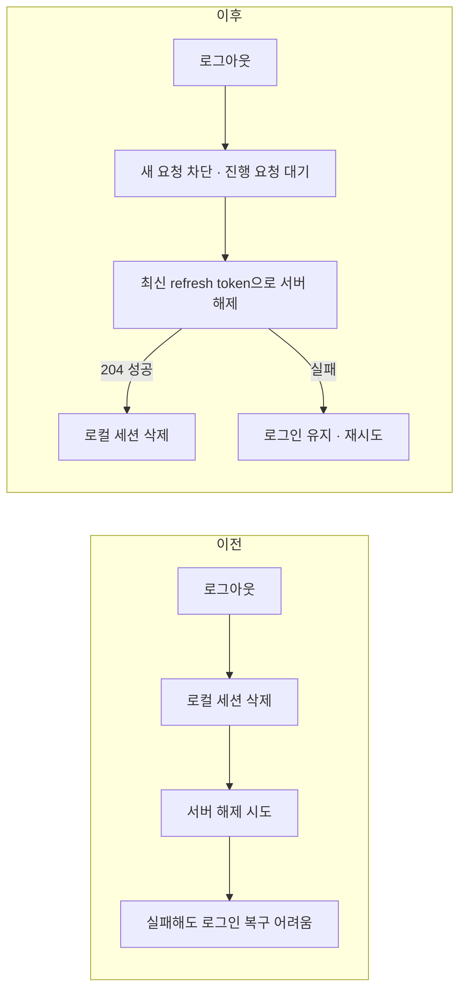
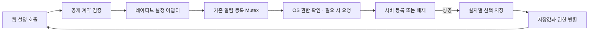
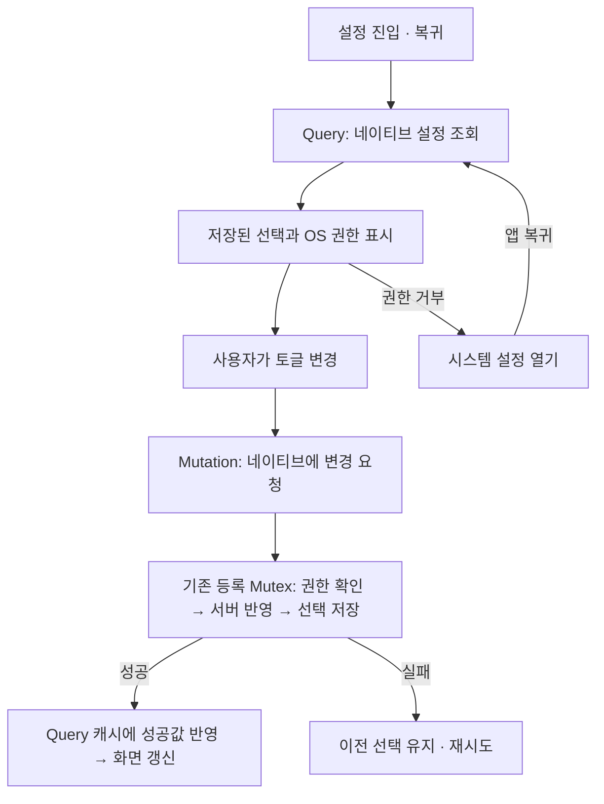
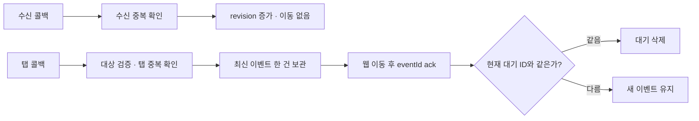
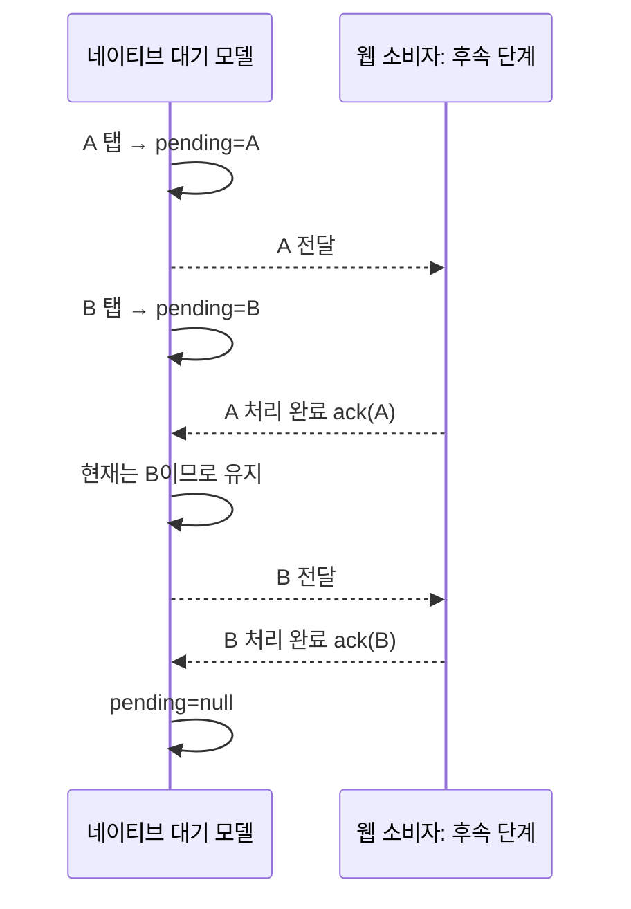
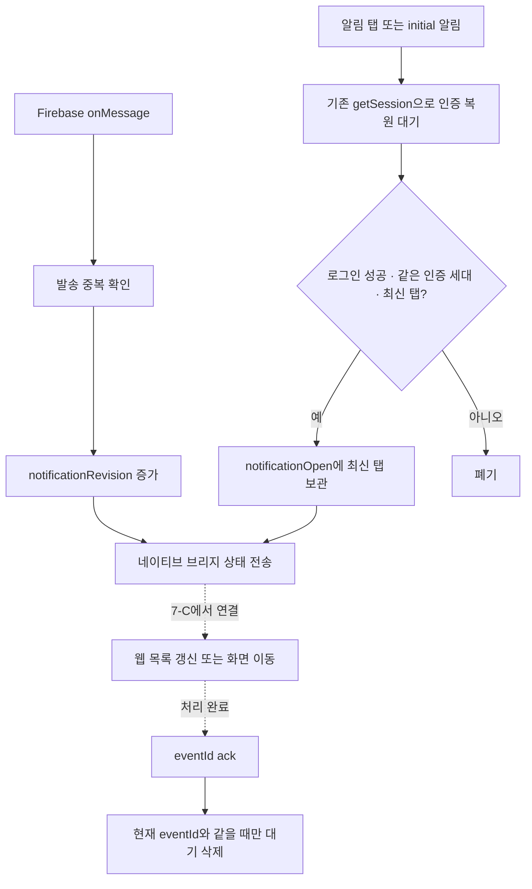
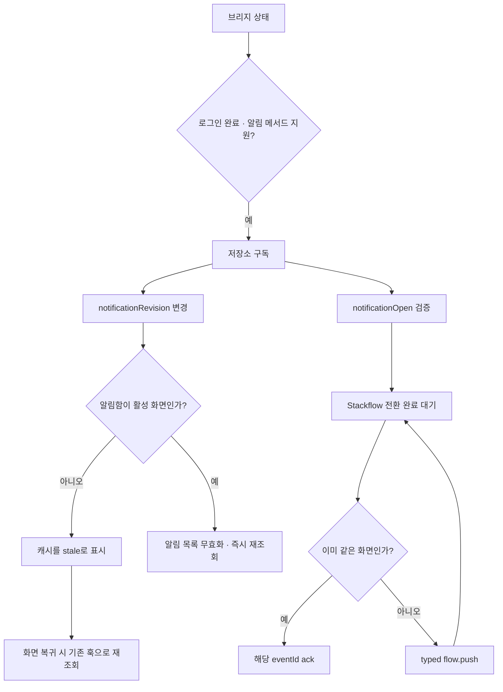

# 알림 구현 변경 전후

## 단계 5: 로그아웃과 기기 해제의 순서

알림 등록이 진행 중일 때 로그아웃하면, 늦게 끝난 요청이 기기를 다시 등록할 수 있다.
서버 세션 해제 성공을 확인한 뒤 로컬 세션을 지우도록 인증 계층에서 순서를 보장한다.
알림 전용 로그아웃 API를 추가하지 않고 기존 인증 계약을 사용한다.

등록 요청의 401 갱신은 기존 SessionManager의 single-flight를 공유한다.
진행 중인 요청의 갱신은 끝낼 수 있지만 로그아웃 시작 후 새 요청은 받지 않는다.
저장소 삭제 실패는 기존 복구 정책을 유지한다.

## 단계 6-A: 웹과 네이티브의 설정 연결

이전에는 웹 설정 화면의 토글이 화면 내부 값만 바꿨다. 새 브리지는 설치별 수신 선택과
OS 권한을 별도로 반환한다. 이 단계에서는 브리지만 완성하며 화면 연결은 6-B에서 진행한다.

- 자동 동기화와 사용자 설정은 같은 Mutex를 공유해 순서 역전을 막는다.
- 수신 선택 ON과 OS 허용은 별개다. 권한 거부 시 사용자 ON 요청은 성공으로 저장하지 않는다.
- 권한 요청 RPC 자체는 수신 선택을 변경하지 않는다.
- 브라우저·구버전 앱은 UNSUPPORTED를 반환하며 FID와 FCM 토큰은 웹에 노출하지 않는다.
- 계정·로그인 수명이 달라진 늦은 응답은 폐기한다.

## 변경 분리와 복구

단계 5는 인증 로그아웃 정책, 6-A는 알림 설정 계약, 6-B는 웹 화면 연결로 검토한다.
커밋 분리만으로 PR 크기가 줄지는 않으므로 실제 PR도 목적별로 분리해야 한다.
설정 계약을 되돌릴 때는 소비하는 웹 화면과 함께 되돌리고, 로그아웃 정책은 독립 검토한다.

## 단계 6-B: 실제 설정 화면

평상시·조회 중·저장 중 설명은 표시하지 않는다. 조회 전과 변경 중에는 스위치를 비활성화한다.
변경 실패는 짧은 오류와 재시도를 제공하고, 권한 차단은 시스템 설정으로 해결하도록 안내한다.

| 항목            | 이전                       | 이후                                         |
| --------------- | -------------------------- | -------------------------------------------- |
| 첫 표시         | `useState(true)`로 항상 ON | 브리지 조회 전 비활성, 조회 후 설치별 저장값 |
| 선택 변경       | 화면 값만 변경             | 네이티브 등록/해제 성공 후 Query 캐시 갱신   |
| 실패            | 오류 표시 없음             | 이전 선택 유지, 조회/변경 각각 재시도        |
| OS 권한 거부    | 표시 없음                  | 저장된 선택과 별도 안내, 시스템 설정 열기    |
| 화면·앱 복귀    | 이전 화면 값 유지          | 활성화·window focus 시 재조회, polling 없음  |
| 브라우저·구버전 | 작동하는 것처럼 토글       | 안내 문구 없이 비활성                        |

웹은 FCM 등록이나 인증 refresh를 직접 구현하지 않는다. 화면 전용 훅은 브리지의 성공/실패를
Query·Mutation 상태로 연결하고, UI는 해당 상태를 표시한다. ON 요청 안에서 네이티브가 권한을
요청하므로 웹에서 권한 요청 RPC를 중복 호출하지 않는다.

계정·sessionId별 Query 키를 사용하고 조회 취소 신호를 확인한다. 계정 경계에서 제거한 캐시는
늦은 mutation 성공으로 다시 생성하지 않는다. 변경 중 조회를 중단해 이전 조회값이 변경 결과와
경합하지 않도록 한다. 시스템 설정 실행 성공은 권한 허용으로 간주하지 않고 복귀 조회로 확인한다.

설명은 `aria-describedby`로 스위치와 연결하며 SEED 입력의 키보드 동작을 사용한다.
실제 APNs/FCM 수신과 알림 탭 이동은 다음 단계 7의 범위다.

### 설정 훅의 책임 분리

`useNotificationSettings`는 설정 조회와 ON/OFF 변경, 성공값 캐시 반영만 조율한다.
`useOpenAppSettingsMutation`은 OS 설정 실행의 진행·실패만 관리한다.
설정 창 실행 성공은 알림 변경 오류를 초기화하지 않는다. 권한 안내는 복귀 후 조회한
현재 OS 권한을 기준으로 갱신하고, 저장된 선택은 실제 변경 성공 전까지 유지한다.
`useQuery`는 화면 활성 상태·변경 진행에 따른 enabled와 조회 취소를 위해 유지한다.

## 단계 7-A: 푸시 대상·대기 모델

이전에는 푸시 탭을 검증하거나 처리 확인할 모델이 없었다. 이제 외부 payload를
POST(양의 안전한 공지 ID) 또는 ALERTS로 제한한다. 임의 URL·본문은 전달하지 않는다.

7-A에서는 순수 모델과 스키마만 검증했다. 그림의 SDK 콜백·웹 이동·브리지 연결은
7-B/7-C에서 구현한다. 계정 교체 때 `clearPendingNotificationOpen()`을 호출하는 책임도 7-B 수명 연결에 있다.

### 현재 코드 읽는 순서와 예시

1. `apps/mobile/src/notifications/push-target.ts`의 `parsePushTarget()`은 외부 입력 변환이다.
   `source=POST, postId="42"`를 `{ type: "POST", postId: 42 }`로 만든다.
   숫자 문자열 형식과 양의 안전한 정수를 확인한다. 일반 알림·잘못된 값은 ALERTS다.
   `notificationId`는 공지 ID로 사용하지 않는다.
2. `deliveryKey`는 발송 중복 판별용이다. POST는 `postPushDeliveryId`, 그 외는
   `notificationId`, 없으면 FCM `messageId`를 사용한다. 종류와 ID를 배열로 직렬화해
   서로 다른 종류의 같은 숫자가 충돌하지 않게 한다. 모두 없으면 중복을 추정하지 않는다.
3. `push-notification-state.ts`의 `recordReceivedPush()`는 수신 이력만 확인하고 `revision`을 증가시킨다.
   revision은 목록 갱신 신호이며 읽지 않은 알림 개수가 아니다.
4. `setPendingNotificationOpen()`은 별도의 탭 이력을 확인하고 새 `eventId`와 대상으로 `pending`을 교체한다.
   동일 메시지의 수신 후 탭은 정상 동작이다. 그래서 receivedDeliveryKeys/openedDeliveryKeys를 분리했다.
5. `acknowledgeNotificationOpen(eventId)`는 현재 pending과 ID가 같을 때만 삭제한다.
   `clearPendingNotificationOpen()`은 계정 경계에서 사용할 폐기 동작이며 실제 인증 구독 연결은 아직 없다.

| 식별자      | 의미                                    | 예시                    |
| ----------- | --------------------------------------- | ----------------------- |
| postId      | 이동할 공지                             | 42                      |
| deliveryKey | 같은 발송의 콜백인지 판별               | `["POST","delivery-7"]` |
| eventId     | 웹이 어느 대기 이벤트를 처리했는지 확인 | notification-open-1     |
| revision    | 새 수신으로 목록 갱신이 필요한지 판별   | 1 → 2                   |

클래스는 SDK 객체가 아니라 프로세스 메모리의 상태를 소유한다. `openSequence`, `notificationRevision`,
`pendingOpen`, 최근 수신/탭 Set이 호출 사이에 유지되어야 해서 사용했다. React 렌더 상태가 아니며
현재 이 클래스 자체에 구독/화면 갱신 기능은 없다. `getNotificationBridgeState()`을 브리지에 반영하는 연결은
7-B에서 구현한다. 전송 확인 없는 단순 boolean 플래그로는 위 A/B 경합을 구분할 수 없다.

### Android와의 비교

2026-11-16에 기존 조사 기준인 Android `855e111f34d2e6df1f23a5ea72682081a82fd8a3`의
소스를 다시 읽었다. 아래 비교는 이 고정 커밋 기준이며 Android 최신 HEAD와 같다는 뜻은 아니다.

| 항목            | Android 기준 코드                                       | 현재 iOS/WebView 구현·계획                        |
| --------------- | ------------------------------------------------------- | ------------------------------------------------- |
| 등록 순서       | PushRegistration의 Mutex                                | 등록 조율기의 p-mutex                             |
| 설정 확정       | 서버 반영 → 현재 세션 확인 → 선택 저장                  | 동일한 정책, 실패 시 이전 선택 유지               |
| 권한과 선택     | ViewModel의 isEnabled/isPermissionGranted               | Query의 enabled/permission                        |
| 공지 대상       | source=POST + 양의 Long postId                          | source=POST + JS 안전한 양의 정수 postId          |
| 대기            | MainActivity.pendingPushPostId 한 건                    | PushNotificationState.pendingOpen 한 건           |
| 처리 완료       | onPushPostOpened → pending=null, Intent extra 제거      | 현재 eventId와 일치하는 ack만 삭제하는 모델 구현  |
| 중복 식별       | 알림 표시 tag가 공지는 postId, 일반은 notificationId    | 발송 단위 deliveryKey, 수신/탭 각각 최근 128건    |
| 일반 푸시       | POST 대상 없으면 별도 공지 이동 없음, 기존 앱 진입 흐름 | 사용자 결정에 따라 ALERTS로 이동하도록 모델링     |
| 화면 전달       | Activity/Compose 내 상태 전달                           | 네이티브 → 검증된 브리지 → Stackflow, 연결 예정   |
| foreground 표시 | YappMessagingService가 NotificationCompat으로 표시      | RNFirebase iOS banner/list 사용 예정, 아직 미연결 |

Android의 notification tag는 시스템 알림 표시·교체용이고 우리 deliveryKey는 콜백 중복
판별용이므로 완전히 같은 기능은 아니다. 같은 공지를 서로 다른 발송으로 보냈다면 우리 모델은
서로 다른 postPushDeliveryId를 구분한다. 또한 eventId ack·revision·브리지 검증은 WebView
경계를 위해 추가한 설계이며 Android를 그대로 번역한 코드가 아니다.

확인한 소스:

- [PushRegistration.kt](https://github.com/YAPP-admin/yapp-plus-android/blob/855e111f34d2e6df1f23a5ea72682081a82fd8a3/app/src/main/java/com/yapp/plus/notification/PushRegistration.kt)
- [NotificationSettingsViewModel.kt](https://github.com/YAPP-admin/yapp-plus-android/blob/855e111f34d2e6df1f23a5ea72682081a82fd8a3/app/src/main/java/com/yapp/plus/notification/NotificationSettingsViewModel.kt)
- [PushNotifications.kt](https://github.com/YAPP-admin/yapp-plus-android/blob/855e111f34d2e6df1f23a5ea72682081a82fd8a3/app/src/main/java/com/yapp/plus/notification/PushNotifications.kt)
- [YappMessagingService.kt](https://github.com/YAPP-admin/yapp-plus-android/blob/855e111f34d2e6df1f23a5ea72682081a82fd8a3/app/src/main/java/com/yapp/plus/notification/YappMessagingService.kt)
- [MainActivity.kt](https://github.com/YAPP-admin/yapp-plus-android/blob/855e111f34d2e6df1f23a5ea72682081a82fd8a3/app/src/main/java/com/yapp/plus/MainActivity.kt)

### 7-A 리뷰 반영: 이름과 입력 검증

클래스 이름은 `PushNotificationState`, 파일은 `push-notification-state.ts`로 통일한다.
Android의 PushRegistration처럼 Push + 역할을 사용하고 TypeScript 파일은 기존 kebab-case를 따른다.
`recordReceivedPush`/`setPendingNotificationOpen`는 화면 이동이 아니라 이벤트 기록임을 나타낸다.
`pendingOpen`, `receivedDeliveryKeys`, `openedDeliveryKeys`로 내부 상태의 의미를 명시한다.

`parsePushTarget`은 네이티브 내부 `pushMessageSchema.parse(input)` 한 번으로 입력을 파싱한다.
객체·필드 존재를 수동으로 검사하거나 변환한 대상을 다시 safeParse하지 않는다.
스키마가 문자열 공지 ID를 안전한 숫자로 변환하고, 잘못된 선택 필드는 undefined로 정규화한다.
그 이후 코드는 POST 여부에 따른 대상 선택과 발송 ID 우선순위만 처리한다.
잘못된 공지 ID는 ALERTS로 보내되 유효한 발송 ID는 보존해 중복 판별에 사용한다.
이 스키마는 모바일 전용이므로 브리지 공개 계약으로 올리지 않는다. Zod는 기존 catalog 4.5.4를
모바일 직접 의존성으로 선언하며 새 버전이나 라이브러리를 도입하지 않는다.

### 등록 직렬화의 구현

NotificationRegistration은 기존 인증 계층과 같은 p-mutex를 사용한다. sync, setEnabled,
requestPermission이 하나의 registrationMutex.withLock을 공유한다. 선택 조회부터 권한 확인,
서버 반영, 선택 저장까지 잠금 안에서 실행한다. 직접 작성한 pending Promise와
enqueue는 제거했다. 세션 경계 확인과 등록 캐시는 그대로 유지한다.

### 설정 변경 실패와 세션 종료의 복구

setEnabled의 서버·저장 실패 또는 예외는 잠금을 해제한 뒤 마지막 저장값을 다시 읽어 한 번
재동기화한다. 복구는 같은 Mutex 안에서 실행하지만 setEnabled를 재귀 호출하지 않는다.
복구 전에 등록 캐시를 비워 동일한 토큰도 서버에 확인한다. 복구 실패는 원래 오류를 덮지 않고
추가 재시도를 예약하지 않는다. 이후 앱 복귀·토큰 변경·사용자 행동에서 다시 시도한다.

세션이 이미 바뀐 작업은 복구하지 않는다. 세션 종료·교체 알림은 clearRegistrationCache로
이전 등록 성공 기록만 비운다. 서버 해제는 기존 로그아웃 계약을 유지한다.

### source·이동 대상·목록 갱신 번호의 구분

백엔드 기준 커밋의 공지 payload는 source=POST, postId, postPushDeliveryId를 보낸다.
일반 푸시는 notificationId만 보내고 source는 생략한다. 모바일 스키마는 POST만 알려진
source로 인정하며 누락·알 수 없는 source는 알림함으로 처리한다. 내부 deliveryKey의
GENERAL은 중복 판별용 구분이지 서버가 보내는 source enum이 아니다.

notificationDestinationTypeSchema는 웹 이동 대상 ALERTS/POST의 Zod enum이다.
notificationOpen.destination은 알림을 눌렀을 때 이동할 알림함 또는 공지 상세를 담는다.
목록 API의 GENERAL/POST 타입은 목록 항목 분류라서 이동 대상 enum과 공유하지 않는다.
notificationRevision은 알림 내용이나 읽지 않은 개수가 아니라 새 수신에 따른 목록 갱신 번호다.

PushNotificationState의 getNotificationBridgeState는 브리지 전달 상태를 반환하고,
setPendingNotificationOpen은 최신 탭 대기를 설정한다. acknowledgeNotificationOpen은
브리지 계약과 이름을 맞췄으며 clearPendingNotificationOpen은 대기를 폐기한다.
trackDeliveryIfNew는 새 발송이면 기록하고 true, 이미 기록한 발송이면 false를 반환한다.

### 7-B — Firebase 이벤트와 브리지 연결

이전에는 PushNotificationState를 순수 모델로만 검증했다. 이제 루트 effect가
startNativeNotificationRuntime을 시작하고 정리하며 Firebase SDK 이벤트를 연결한다.
등록 동기화 런타임과 수신·탭 런타임은 서로 다른 책임으로 유지한다.

notification-runtime.ts는 인증·이벤트 순서를 처리하고 native-notification-runtime.ts는
Firebase·기존 인증·브리지를 연결한다. 인증 모듈 자체는 수정하지 않았다.
세션 복원은 기다리되, 로그아웃·계정 교체 전 시작된 비동기 탭은 인증 세대로 폐기한다.
같은 세션의 토큰 갱신은 대기를 유지한다. 초기 알림 조회는 effect 재시작에도 공유하고,
늦게 도착한 초기 알림이 더 최근 탭을 덮어쓰지 않도록 순서를 확인한다.

앱 범위 PushNotificationState가 WebView 재마운트에도 대기를 보존한다.
ack RPC는 Zod로 입력을 검증하며 오래된 eventId는 최신 대기를 지우지 않는다.
웹 초기값은 대기 없음과 revision 0이다. 아직 웹 탐색·목록 갱신 소비자는 연결하지 않았다.

firebase.json의 banner/list 설정은 iOS 포그라운드 표시를 SDK에 맡긴다.
별도 로컬 알림은 만들지 않는다. 네이티브 빌드에 포함되는 설정이므로 새 빌드가 필요하다.

수신·탭 런타임의 시작 부분은 이름 있는 처리 함수를 구독에 연결하고 정리 함수를 반환한다.
handleSessionChange는 이전 세션 대기를 비우고, handlePushReceived는 수신 갱신 번호를,
handleNotificationOpened는 최신 탭 수락을 담당한다. getInitialNotificationOnce는 초기
조회 재사용을, consumeInitialNotification은 조회 결과 소비를 담당한다.
실제로 바뀌는 latestOpen·initial은 앱 런타임 범위에, active·sessionId는 구독 범위에 둔다.
const 객체로 가변 상태를 숨기거나 추가 클래스를 만들지 않는다.

추가 리뷰에서 긴 비동기 처리인 acceptOpen과 consumeInitialNotification은 파일 범위의
비공개 함수로 추출했다. 두 함수는 NotificationOpenContext로 인증 조회·상태 반영·현재 작업
유효성 확인만 전달받는다. isActive/isCurrentOpen은 호출할 때 최신 구독 상태를 읽으므로
await 이후 로그아웃·새 탭·정리 여부를 그대로 확인한다. 초기 조회 캐시와 짧은 구독 콜백은
런타임 내부에 남겨 상태 소유를 유지한다.

### 7-C — 웹 탐색과 알림 목록 갱신

이전에는 네이티브가 브리지에 상태를 보관하는 데서 끝났다. 이제
notificationNavigationPlugin이 Stackflow 안에서 로그인 완료와 알림 메서드 지원 여부를 확인한
뒤 브리지 저장소를 구독한다. 계정·세션이 바뀌면 소비자를 새로 만들고 로그아웃하면 구독을
해제한다. 인증 코드 자체는 변경하지 않았다.

공지 탭은 NoticeDetail의 noticeId로, 일반 알림은 Alerts로 이동한다. 로그인 화면에서
시작하면 기존 인증 리다이렉트가 Tabs를 준비한 뒤 이동한다. 이미 같은 대상이면 중복 push를
하지 않으며 대상 Activity가 최상단이고 전환이 끝난 뒤에만 ack를 보낸다.
이동 요청 중 같은 이벤트가 다시 렌더링되어도 중복 요청하지 않는다. ack 실패는 다음 상태
반영·WebView 재마운트에서 다시 확인할 수 있도록 기록을 비운다. 별도 재시도 폴링은 없다.

수신은 탐색을 만들지 않는다. alerts-query.ts의 invalidateAlertsForPush는 기존 생성 query
key로 목록을 무효화하고 화면 활성 여부에 따라 즉시 재조회 여부를 정한다.
숨겨진 목록은 기존 useRefetchOnScreenReturn과 재진입 조회를 사용한다.
알림함 읽음 처리나 시스템 알림 삭제는 이 ack와 별개다.

새 클래스·의존성·인증 API·브리지 공개 계약은 추가하지 않았다. 롤백은 이 웹 변경을 되돌리거나
이전 검증 웹 배포로 복구하면 된다. 네이티브는 대기 상태를 보관하며 브리지 필드의 추가는
기존 웹과 호환된다. 실제 FCM→APNs→실기기→WebView 전체 경로 검증은 아직 남아 있다.

7-C 리뷰에서 목록 갱신을 usePushAlertsRefresh로 분리했다. effect는 수신 번호 변경만
실행 계기로 삼고, useEffectEvent가 실행 시점의 알림함 활성 상태와 QueryClient를 읽는다.
화면 전환만으로 수신 처리를 반복하지 않으므로 receivedRevision ref는 제거했다.
이동·ack 중복 방지를 위한 두 ref와 탐색 준비 상태에 반응하는 effect는 유지한다.
Strict Mode의 effect 재실행까지 한 번으로 제한하지는 않으며, 캐시 무효화는 반복 가능하다.

탐색 effect도 역할별로 정리했다. isNavigationReady가 전환 완료·로그인 부모 준비 조건을
설명하고, 파일 범위의 isNotificationDestination은 동일 대상 여부를 판단한다.
pushNotificationDestination은 typed 이동만, acknowledgeOpenOnce는 ack 중복 방지와
실패 시 재확인 기록 정리만 담당한다. effect에는 입력 검증·준비 대기 → 같은 대상 ack →
중복 이동 차단 → 이동 순서가 남는다. 새 상태 모델이나 중첩 함수를 추가하지 않았다.

### 브리지 상태와 effect 선택 이유

| 상태                 | 변경 계기           | 소비 목적                  |
| -------------------- | ------------------- | -------------------------- |
| safeAreaInsets       | 화면 안전 영역 변경 | 화면 여백 적용             |
| notificationRevision | 새 푸시 수신        | 알림 목록 갱신             |
| notificationOpen     | 시스템 푸시를 누름  | 공지 상세 또는 알림함 이동 |

safe-area에는 알림 revision이 필요하지 않다. 브리지 저장소 전체 구독은 어느 필드의
변경에도 호출될 수 있으므로, 직접 구독에서 알림을 처리한다면 이전 revision과 비교해야 한다.
여기서 탭은 하단 메뉴 선택이 아니라 시스템 푸시를 누르는 동작이다. 백그라운드 탭은
onNotificationOpenedApp, 종료 상태에서 푸시로 시작한 앱은 getInitialNotification으로 처리한다.

직접 구독 콜백에서 invalidateQueries를 실행하는 방식도 가능하다. 현재는 이미
useSyncExternalStore가 브리지 상태를 React에 전달하므로 수신 번호에 반응하는 작은 effect를
유지한다. 별도 구독 수명·이전 번호·최신 화면 상태 전달을 추가하지 않는 선택이다.
useEffectEvent는 실행 계기를 만들지 않고, 수신 처리 시 최신 활성 상태를 읽는 데 사용한다.
캐시 변경과 요청은 렌더링 중 직접 실행하지 않는다.

탐색은 수신과 달리 대기 이벤트뿐 아니라 인증·화면 준비 완료에도 반응해야 한다.
따라서 화면 준비 의존성을 Effect Event 안에 숨기지 않는다. 이동·ack의 두 ref는 최신 값을
읽기 위한 우회가 아니라 이미 요청한 작업의 기록이며, 재렌더링 중 중복 실행을 막는다.
