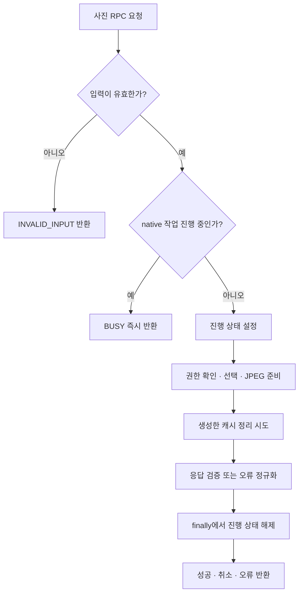
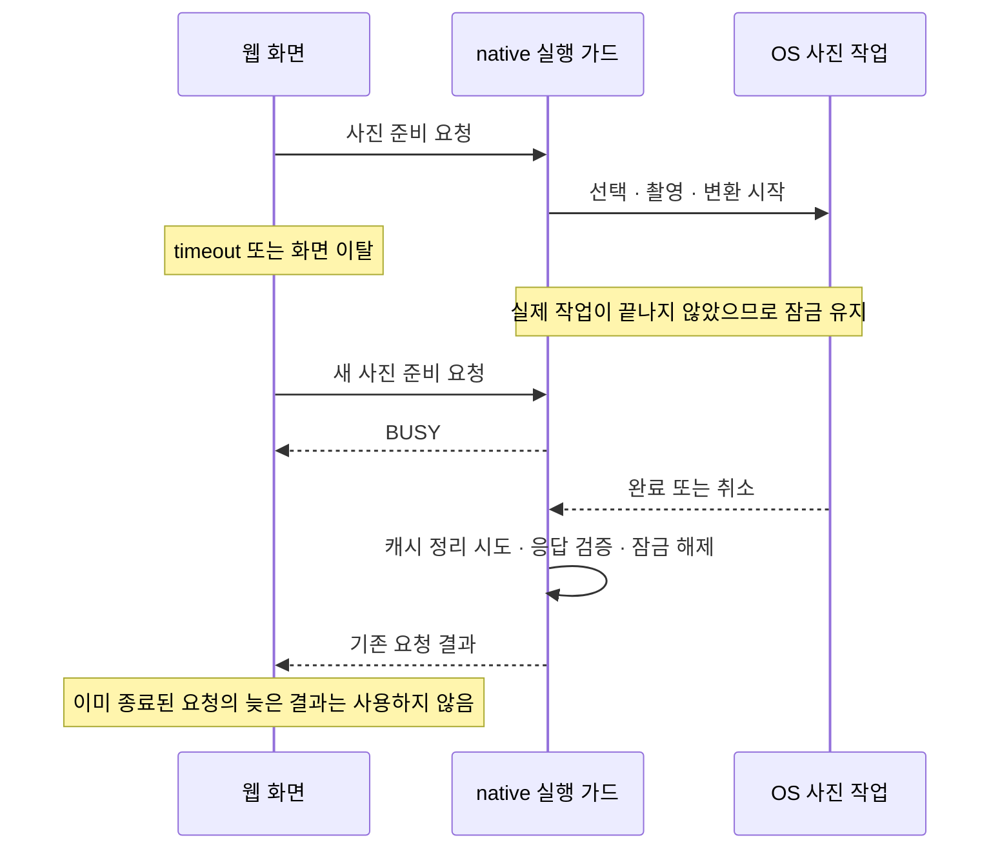

# 사진 준비 작업의 실행 제어와 책임 분리

이 문서는 [사진 RPC 계약](contracts/submission.md)을 구현할 때 적용할 설계 결정이다. 사진 선택·변환을 수행하는 native 작업과 웹 화면의 요청 상태를 구분한다.

## 중복 요청 정책

사진 준비 작업이 진행 중이면 새 요청은 즉시 `BUSY`로 거절한다. 요청을 대기열에 넣거나 기존 사진 결과를 공유하지 않는다. 선택기가 닫힌 직후 다시 열리거나 서로 다른 호출자가 같은 사진을 받는 일을 방지하기 위해서다.

웹의 React Query `useMutation`은 로딩 표시·버튼 비활성화를 담당한다. 웹 요청이 timeout되거나 화면이 사라져도 OS 선택·변환 작업은 계속될 수 있으므로 native 실행 제어를 대체하지 않는다. native 잠금은 실제 작업과 정리 시도가 끝날 때 해제한다.

## 패턴 비교와 선택

| 방식                                   | 중복 요청 동작                | 판단                                                                          |
| -------------------------------------- | ----------------------------- | ----------------------------------------------------------------------------- |
| 지역 boolean 실행 가드 + `try/finally` | 진행 중이면 즉시 거절         | 현재 선택. 작은 범위에서 정책과 잠금 수명이 명확하다.                         |
| Try-lock의 `tryAcquire()`              | 획득 실패 시 즉시 거절        | 정책에 맞지만 비차단 획득을 지원하는 API가 필요하다.                          |
| 실행 중 Promise 보관                   | Promise가 있으면 거절         | 작업 자체를 표현하지만 완료·실패 시 참조 정리가 여전히 필요하다.              |
| 상태 머신                              | `idle` 이외 상태에서 거절     | 단계별 취소·복구·진행 표시 요구가 생기면 검토한다. 현재는 도입하지 않는다.    |
| 직렬 큐·일반 mutex                     | 기다렸다가 실행               | 사진 선택기가 연속으로 열릴 수 있어 현재 정책에 맞지 않는다.                  |
| Single-flight                          | 기존 Promise를 공유           | 호출자들이 같은 사진 결과를 받으므로 현재 정책과 다르다.                      |
| Latest-wins                            | 이전 작업 취소 또는 결과 무시 | 결과 무시만으로 OS 선택기가 닫히지 않으므로 현재 실행 제어를 대체하지 못한다. |

`p-mutex.withLock()`만 사용하면 기존 거절 정책이 대기 정책으로 바뀐다. 검토한 `p-mutex` 1.0.0에서는 `isLocked` 검사 직후 `withLock()`을 호출하면 동기적으로 잠금이 잡히므로 거절 정책을 유지할 수 있다. 하지만 두 호출 사이에 `await`를 넣지 않아야 하는 제약과 라이브러리 구현에 대한 의존이 추가된다. 이 기능에는 대기열이 필요 없으므로 줄 수를 줄이기 위해 mutex로 바꾸지는 않는다.

잠금 변수는 `isPhotoOperationInProgress`로 표현하고 첫 비동기 작업 전에 확인·설정한다. 성공·취소·예외·응답 검증 실패 모두 `finally`에서 해제한다. OS 선택기의 수명을 알 수 없는 웹 timeout만으로 잠금을 풀지 않는다.

## 실행 흐름

## 책임과 확장 기준

- 액션 경계: 입력 검증, 중복 실행 거절, 응답 검증, 원문 오류 정규화.
- `prepare`: 권한 확인 → 선택 → 변환의 순서와 파일 정리 수명.
- `resolveCameraPermission`: 필요한 경우에만 카메라 권한 요청.
- `renderPhoto`: 제한된 크기로 이미지 해독, 생성한 변환 컨텍스트 해제.
- `convertPhoto`: JPEG 저장·용량 확인·Base64 읽기, 생성한 이미지 참조 해제.
- `removeTemporaryFile`: 이번 호출의 앱 캐시만 삭제. 파일별 예외를 처리해 나머지 정리를 계속하고 사진 준비 결과는 유지한다. 삭제하지 못한 파일은 캐시에 남을 수 있다.

화면 렌더링과 관계없는 자원 수명은 React state나 별도 전역 상태로 옮기지 않는다. 함수 반환값과 `try/finally`로 표현한다. 같은 거절 정책의 실제 소비자가 반복되면 `rejectWhileRunning` 같은 작은 실행 제어 함수로 추출할 수 있지만, 현재는 사용처 하나를 위해 공용 추상화를 만들지 않는다.

이 문서의 선택은 지역 boolean 가드다. 문서 작성 시 작업 트리에는 비교 과정에서 작성한 `p-mutex` 구현이 남아 있다. 후속 구현 리뷰에서 이 결정에 맞춰 정리하고 중복 요청 거절·잠금 해제·캐시 삭제 실패 시 결과 유지 테스트를 확인해야 한다. 문서 확정은 해당 구현 변경이나 실기기 검증 완료를 의미하지 않는다.
