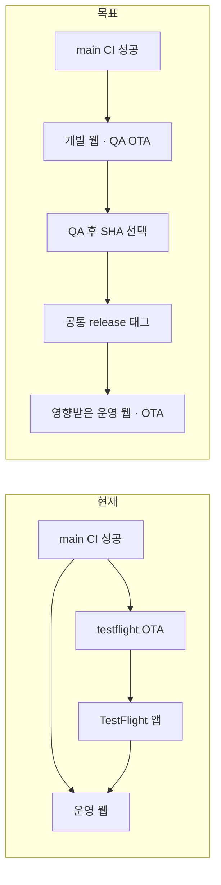

# 조사와 결정

**확인일**: 2026-11-23. 코드 기준은 `cc90b35e`이며 외부 서비스 설정 완료와 구분한다.

## 현재와 목표

그림은 자동 경로다. IPA 빌드·제출·App Store 출시는 두 구조 모두 수동이며 운영 IPA는 별도 검증한다.

## 1. 공통 태그와 appVersion 유지

- 결정: main 개발 자동 배포, 정식 release-vX.Y.Z 운영 배포, 대상별 affected를 사용한다.
- 이유: 현재 검증 SHA·수동 local build를 재사용한다. 별도 장기 브랜치나 앱별 태그는 필요하지 않다.
- 대안: develop/production 브랜치는 병합·동기화 부담, Expo Workflows 전환은 이번 범위를 넘는다.
- runtime은 appVersion을 유지한다. 이미 Expo fingerprint와 빌드 입력 digest로 버전 증가 누락을 검사한다.
  workflow의 fingerprint 빌드 선택과 fingerprint runtime 정책은 별개이며 정책 전환은 하지 않는다.
- 근거: [Expo production](https://docs.expo.dev/tutorial/cicd/production/),
  [태그](https://docs.expo.dev/tutorial/cicd/tag-based-releases/),
  [runtime](https://docs.expo.dev/versions/latest/sdk/updates/#runtime-version).

## 2. Vercel 개발 전용 alias

- 결정: 자동 branch URL 대신 개발 workflow만 이동시키는 전용
  `yapp-plus-web-dev.vercel.app` alias를 사용한다.
- 이유: main SHA를 운영으로 다시 배포하므로 branch URL을 Preview 전용으로 가정하면 안 된다.
  API는 *.vercel.app alias를 지원한다. 첫 검증된 개발 배포에서 가용성을 확인·연결하므로 도메인을
  구매하거나 임의 Preview에 미리 연결하지 않는다.
- 대안: 별도 Vercel 프로젝트·유료 custom environment는 현재 요구에 불필요하다.
- CLI의 pull --git-branch는 env 조회이고 업로드의 Git 출처 표시는 별개다. detached checkout에는
  provider metadata를 명시하며 실제 alias가 READY 배포를 가리키는지 확인한다.
- 근거: [Alias API](https://vercel.com/docs/rest-api/aliases/assign-an-alias),
  [CLI Git metadata](https://vercel.com/docs/cli/deploy#associate-a-cli-deployment-with-a-git-branch).

## 3. Doppler와 빌드 입력

- 결정: yapp-plus-web 프로젝트의 dev/prd를 Vercel Preview/Production에 각각 동기화한다.
- 이유: 현재 vercel pull/build 절차를 유지하며 GitHub Secrets에 공개 API 주소를 중복 보관하지 않는다.
- 대안: CI의 Doppler 직접 다운로드 경로를 추가하면 공급 경로가 이중화되므로 사용하지 않는다.
- 공개 VITE_API_BASE_URL은 Unmasked/Config로 공급하고 branch override·자동 redeploy를 확인한다.
  값 변경은 기존 bundle을 바꾸지 않으므로 동일 검증 SHA의 force 재빌드와 캐시 입력 관리가 필요하다.
- 근거: [Doppler Vercel](https://docs.doppler.com/docs/vercel),
  [Vercel 환경 변수](https://vercel.com/docs/environment-variables).

## 4. EAS 환경과 iOS 입력

- 결정: testflight의 environment=preview, production의 environment=production을 명시한다.
  store 배포의 기본 환경 추론에 의존하지 않고 OTA에도 같은 environment를 지정한다.
- 이유: OTA에는 EAS_BUILD_PROFILE이 없을 수 있다. local build는 EAS secret file을 자동 제공하지 않는다.
  공개 입력은 EAS 환경, plist는 GitHub 환경별 Secret로 공급하고 app config의 파일 필수 검사는 IPA에 한정한다.
- 대안: eas.json·workflow별 URL 중복 고정과 production 전체 평가에서 plist 강제는 배제한다.
- PR에서는 비밀 없는 고정 fixture로 동일 입력을 비교하고 실제 Firebase·OAuth 조합은 인증된 빌드 전 확인한다.
- 근거: [EAS 환경](https://docs.expo.dev/eas/environment-variables/usage/),
  [local build 제약](https://docs.expo.dev/build-reference/local-builds/).

## 5. 기존 기록·저장소 재사용

- 결정: 웹 성공 SHA는 GitHub Deployment, 모바일 기준은 현재 EAS list/view를 환경별로 확장한다.
  알림 선택은 기존 Firebase project/FID 키를 유지하고 환경 없는 로그인 세션 키만 분리한다.
- 이유: 별도 OTA 활성화 파일·자동 빌드 registry·새 FID는 불필요하다. #131·#132의 회귀 조건을 함께 검증한다.
- 대안: 직전 push/태그 기준은 실패한 배포의 누적 변경을 누락하며 웹·OTA의 단일 성공 SHA도 부적합하다.

## 활성화 전 확인할 사항

설계 선택은 위와 같이 확정했다. API·OAuth·Firebase 값과 접근 권한은 외부 준비 입력이다.
부족한 값으로 production fallback하거나 임의 예시 값을 활성화하지 않는다. 실제 준비 상태는
[validation.md](validation.md)에만 기록하며 단계 진행 확인 전 외부 자원을 만들지 않는다.
